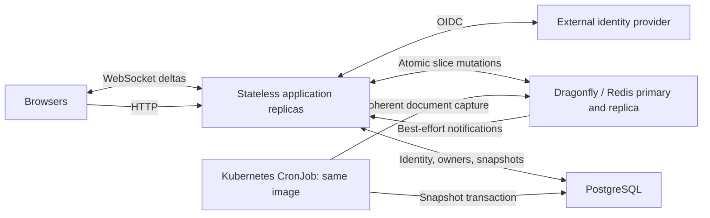

---
agentControls:
  test:
    label: Test
    enabled: true
    description: Run relevant application tests and verification. When off, skip them and report the unverified behavior.
  build:
    label: Build
    enabled: true
    description: Build application artifacts and container images. When off, do not build publishable artifacts or push images; compilation required for enabled tests is allowed.
  deploy:
    label: Deploy
    enabled: true
    description: Deploy the application in the assigned namespace using verified artifacts. When off, prepare manifests but do not deploy or update application workloads. Respect the Build control.
---

# Collaborative plaintext pad specification

Status: design draft. This document specifies behavior and architecture only; it does not authorize implementation or deployment. Snapshot history matters; durable per-edit replay/history does not.

## 1. Product

Build an Etherpad-like collaborative editor for plaintext, primarily Markdown. Local typing should feel immediate. Connected users see incremental text changes and live authorship coloring. Application replicas can serve the same page without sticky sessions.

- Split text dynamically into linked slices. An insertion inside a slice splits it, inserts new text, and changes only affected slices and links.
- Keep active text and attribution in Dragonfly/Redis. Commit immutable plaintext snapshots and document-level contributor relations to PostgreSQL.
- Autosave runs server-side even when every browser has closed.
- Save creates a manual snapshot. Compare snapshots and revert to an earlier snapshot.
- Preview renders the draft. Publish shares a rendered, explicitly selected snapshot.
- Authenticate through an external OpenID Connect provider.
- The creator is an owner. Owners can add owners, remove other owners, and choose private, public read-only, or public read-write access.

Initial scope excludes rich-text storage, binary attachments, durable keystroke history, arbitrary offline collaboration, comments, folders, and complex role hierarchies. Text remains independently usable as a UTF-8 `.md` or `.txt` download.

## 2. Decisions and proposals

| Topic | Design |
| --- | --- |
| Source content | Plain UTF-8 text; Markdown rendering is derived output |
| Active state | Dragonfly using a deliberately tested Redis-compatible command subset |
| Text representation | Bounded attributed slices in a doubly linked list, with a balanced length index |
| Concurrency | Server-ordered operational transformation (OT), using a vetted text algorithm |
| Transport | WebSocket for editing and presence; HTTP for snapshots and management |
| SSE | Optional read-only event transport; editing fallback would also need HTTP POST |
| Edit history | No durable operation journal; only a bounded transient OT window |
| Persistence | Immutable full-text snapshots in PostgreSQL |
| Autosave | Kubernetes CronJob invoking a maintenance command in the same application image |
| Identity | OIDC; proposed first-party backend session/BFF boundary |
| ACL | Three modes plus a set of equal owners |
| Publish | Owner-controlled pointer to a durable snapshot; publishing never changes the ACL implicitly |

OIDC session/BFF is a proposal for this browser-first product. Confirm that boundary before implementing authentication. Direct token API access becomes relevant if independent mobile, CLI, or third-party clients are required.

## 3. Architecture



PostgreSQL owns identities, owners, access mode, publication pointers, and durable snapshots. Dragonfly owns the current active document between snapshots. Local application memory holds disposable indexes and socket state only.

This is HA for application replicas and a replicated active store, with explicitly bounded durability. Redis replication and periodic PostgreSQL snapshots do not guarantee zero loss of acknowledged draft edits. Durable snapshots survive according to the separately configured PostgreSQL replication and backup guarantees.

## 4. Text slices and incremental editing

### 4.1 Slice model

A slice contains:

- An opaque slice ID, previous/next IDs, UTF-8 text, and measured UTF-16 length.
- A verified author ID or `unknown` attribution.
- A generation/version for detecting stale cached structure.

Text is inline in bounded slices initially. Splitting copies at most the affected slice, rather than the document. Immutable backing buffers with range references are a later optimization only if profiling justifies their lifecycle and garbage-collection costs.

Example: Alice's slice `hello world`, with Bob inserting `brave ` before `world`, becomes:

```text
[Alice: "hello "] <-> [Bob: "brave "] <-> [Alice: "world"]
```

Adjacent compatible slices can merge. Empty slices are removed. Large pastes are divided into bounded chunks. Deletion trims boundary slices, removes fully covered slices, and reconnects surviving neighbors. Replacement is one atomic delete-plus-insert transaction.

The author of retained text stays unchanged. New text receives the authenticated editor's author ID; author fields submitted by browsers are ignored. Deletion credits the deleting user as a contributor without assigning them the surviving text.

### 4.2 A linked list also needs an index

A plain linked list has linear random-position lookup. Keep a balanced tree over the slices with subtree UTF-16 lengths and, where useful, line counts. Store authoritative index nodes alongside slices; replicas may cache a matching version. Maintain index paths and neighboring links in the same atomic mutation.

- Position lookup: target `O(log S)` for `S` slices.
- Insert: target `O(log S + inserted bytes)` plus bounded boundary copying.
- Delete spanning `K` slices: target `O(log S + K + affected bytes)`.
- Full-text download, snapshotting, and full rendering remain `O(document size)`.
- Do not rewrite every later absolute offset after insertion.
- Do not send full documents or rebuild the editor DOM on ordinary accepted edits.

Start with a 1–4 KiB target slice size and an 8 KiB maximum, always splitting on valid character boundaries. These are benchmark inputs, not established optimal constants. Attribution boundaries can create smaller slices. Coalesce adjacent slices only when authorship matches; never discard attribution to satisfy a size target.

Alternating authors and scattered edits can produce pathological fragmentation. Measure slice count and metadata bytes, run bounded compaction, and enforce a configurable metadata budget. If that budget is reached, reject further growth with a recoverable error and preserve existing content; do not silently collapse attribution.

### 4.3 Unicode and editor behavior

The wire protocol and index use UTF-16 code units to match browser/editor positions. Storage is valid UTF-8. Maintain conversion metadata per slice. Reject malformed UTF-8, unpaired surrogate input, invalid ranges, and splits inside surrogate pairs. Grapheme-aware movement and deletion belong to the editor; test emoji sequences, combining marks, RTL, and IME composition.

New documents and imports normalize line endings to LF. Subsequent text is not silently normalized or trimmed. Export preserves the document's actual trailing-newline state. Clipboard paste and IME composition arrive as edit transactions, not artificial per-character requests.

## 5. Concurrency without durable edit history

Slice storage is an optimization, not a concurrency algorithm. Concurrent edits cannot safely overwrite linked pointers based on stale browser state.

Use server-ordered text OT with an established algorithm/library whose license and correctness suit the project. Reuse its transformation semantics rather than inventing pairwise insertion/deletion rules. Etherpad's changeset model is a reference, not a commitment to importing the entire Etherpad application. CRDTs remain an alternative if true offline merging later becomes essential, but introduce additional persisted identity/tombstone/state requirements.

An edit includes protocol version, document epoch, client/session ID, operation ID, base revision, and a text changeset. Slice IDs are internal storage addresses and are not long-lived browser edit anchors.

1. Authenticate the connection and authorize the operation.
2. Transform the edit from its base revision through the bounded recent OT window.
3. Resolve affected slices and prepare a mutation against an observed head revision.
4. Execute a bounded atomic script/function that validates the epoch, revision, ACL generation, operation ID, ranges, and storage budget before making any writes.
5. Update slices, index paths, current revision, contributor set, recent OT window, deduplication data, and dirty scheduling together.
6. Notify connected replicas of the accepted changeset and revision. The sender receives an acknowledgment with the same operation ID.

Competing servers use compare-and-set on the current revision and recompute on conflict. They do not acquire correctness-critical in-memory document locks. Atomic scripts must perform all predictable validation before mutation: script atomicity does not imply rollback of earlier writes after a runtime error. Preflight key types, use predictable commands, enforce capacity headroom, and treat unexpected partial failure as document quarantine and repair, never a successful acknowledgment.

The OT window and duplicate acknowledgment cache are transient and bounded by age, operation count, and bytes. Initial tuning proposal: two minutes and at most 2,000 changesets per document, subject to byte limits. They exist for overlapping connected edits and reconnects, not user-visible edit history or crash recovery.

- Retry the same operation ID when the acknowledgment is uncertain; never generate a new ID for the same edit.
- Detect revision gaps and request current state. No durable edit replay API is required.
- An operation older than the OT/deduplication window is rejected for resynchronization, never blindly reapplied.
- On resynchronization, preserve any unacknowledged local text as a recoverable draft. Offer comparison/copy rather than overwriting newer server text.
- Collaborative undo transforms the user's inverse edits through concurrent changes. Whole-document restore is a separate owner action.

Specify and test same-position inserts, overlapping deletions, insert-inside-delete, replacement, cursor affinity, and convergence before choosing the OT dependency. Optimizing the storage format must not change those semantics.

## 6. Dragonfly/Redis layout

Use a document hash containing metadata, encoded slice records, index nodes, contributor IDs, and bounded transient OT/deduplication fields. Updating a hash field changes only that record; it does not serialize the entire document value.

Conceptual keys:

```text
pad:{bucket}:<document-id>:state    document hash
pad:{bucket}:<document-id>:presence ephemeral presence
pad:{bucket}:dirty                 sorted set of due documents
```

`bucket` is a stable, configured partition derived from the document ID. The hash tag places a document and its dirty set in one Redis Cluster slot, allowing their updates in one atomic operation. Bucket count must balance dirty discovery and shard distribution. No global dirty key is required in the edit transaction.

Metadata includes epoch, current revision, head/tail slice, index root, total lengths, ACL generation/gate, last snapshot watermark, dirty state, first dirty time, last edit time, and schema version. A revision number alone is not an identity across complete cache reconstruction; include the epoch.

- Disable eviction of unsnapshotted documents. Memory exhaustion rejects new mutations instead of evicting accepted draft text.
- Active state has no expiry while dirty. Presence and transient protocol state have independent retention rules.
- Delete dead slice/index fields promptly; bound deduplication and OT metadata.
- Batch reads and writes. Avoid one network round trip per linked-list hop.
- Hash sizes must be bounded to keep atomic operations and snapshot reads predictable.
- Test scripts, hashes, sorted sets, Pub/Sub, TLS, failover, and any replication acknowledgment command on the exact Dragonfly server version. Redis protocol compatibility does not prove identical durability or cluster behavior.

An eventual move to separately keyed slices or immutable roots requires a replacement coherent snapshot protocol. Do not distribute chunks across keys and assume a sequence of reads captures one revision.

## 7. WebSocket updates and recovery

Use a WebSocket for bidirectional edits, accepted changesets, cursors, presence, snapshot notifications, and permission changes. Authorize both the handshake and subsequent sensitive actions. Check Origin and session validity; enforce message-size and rate limits.

Initial sync returns one coherent document state with epoch, revision, text, attribution runs, permissions, and snapshot watermark. A replica buffers notifications during initial sync, drops those already covered by the returned revision, and detects gaps before forwarding subsequent updates.

Use Redis Pub/Sub for immediate fan-out, backed by revision checks and periodic head checks. Pub/Sub can lose notifications; it is not the authoritative text or a durable queue. A gap triggers current-state resynchronization, optionally using the transient OT window when still available. No Redis Streams journal is required.

Every application replica with local viewers must receive a document's notifications. A single shared consumer group would divide updates among replicas and is unsuitable for broadcast.

- Heartbeats detect dead sockets and missed heads; reconnect uses exponential backoff and jitter.
- Slow clients have bounded outgoing queues and are disconnected with a resync reason when they fall behind.
- Presence has TTLs, is disposable, and is excluded from snapshots.
- Existing sockets drain gracefully during deployment; any application replica can handle reconnect.
- Session expiration or access revocation stops forwarding protected text as well as rejecting writes.

SSE is suitable for read-only viewers. If enabled, event IDs carry epoch/revision and gaps produce a full resync; HTTP mutations require equivalent authorization, CSRF protection, and idempotency. Ship WebSocket first unless a concrete proxy/network limitation requires another transport.

## 8. Snapshots and browser-independent autosave

### 8.1 Snapshot content

A snapshot contains full plaintext, its checksum, epoch/revision, timestamp, kind (`auto`, `manual`, `pre_revert`, `revert`, or `publish`), requester where applicable, and a set of document contributors. The text is self-contained; reading history never requires replaying keystrokes.

The snapshot-to-authors SQL relation represents cumulative contributors through that revision, including deleting editors and inherited contributors after restore. It is many-to-many between snapshots and users, expressed as one snapshot with many contributor rows. It is not evidence of which current characters belong to which author.

Per-slice authorship intentionally stays in Redis. After Redis reconstruction from plaintext or snapshot revert, restored text is marked `unknown`; retain the snapshot's contributor set. Do not paint restored text as authored by the restoring owner. Preserving precise historical attribution would require an attribution sidecar, which is outside the initial requirement.

### 8.2 Coherent capture

Read the document hash with one `HGETALL` command, obtaining metadata, links, slices, index records, and contributor state at one atomic command boundary. Assemble the text outside Redis and validate link consistency, lengths, epoch/revision, and checksum. This is an `O(document size)` operation on the snapshot path, not every keystroke.

Benchmark `HGETALL` latency with the configured maximum text and metadata size; an oversized hash can stall unrelated work. Separate heavy snapshot/diff/render CPU work from WebSocket serving and cap capture concurrency. If measurements violate the edit-latency budget, use immutable versioned snapshot roots or a tested server checkpoint facility rather than accepting inconsistent multi-command reads.

Persist text and contributor rows in one PostgreSQL transaction. Make `(document_id, epoch, revision)` unique and attach retryable request records/bookmarks to the existing row when appropriate. A manual save at an already captured revision succeeds and remains identifiable as a user-requested save without duplicating the body.

After PostgreSQL commits, acknowledge the captured watermark in Redis conditionally. Clear dirty scheduling only if the current epoch/revision still matches the capture. If newer edits arrived, leave the document due. An older worker must never decrease either store's snapshot watermark.

There is no transaction spanning Redis and PostgreSQL. PostgreSQL success followed by a lost Redis acknowledgment is safe: the next attempt deduplicates and reconciles. Redis must not be marked clean before the SQL transaction commits.

### 8.3 Autosave scheduling

The same image exposes a finite `snapshot-dirty` maintenance command. A Kubernetes CronJob runs it every minute in UTC with `concurrencyPolicy: Forbid`, a bounded execution deadline, retry limits, and bounded document batches.

The edit transaction atomically schedules the document in its bucket's dirty sorted set. Preserve the first dirty deadline: continued typing must not defer autosave indefinitely. The job reads due entries across all configured buckets and takes snapshots regardless of connected browsers. Do not rely on unload handlers, socket disconnects, or a frontend save timer.

Proposed normal-operation target: any accepted edit is included in a durable snapshot within 90 seconds. This is an SLO conditional on dependency and scheduler health, not a guarantee through an outage. Monitor the oldest unsnapshotted edit. Optional idle/disconnect requests may accelerate saving but do not replace the CronJob.

CronJobs can be delayed or duplicated. Use per-document leases with random tokens and conditional release to reduce duplicate work, plus PostgreSQL uniqueness and monotonic watermark conditions for correctness after lease expiry. Duplicate workers must be harmless.

Dirty entries remain until SQL commit and conditional cleanup. Periodic maintenance reconciles document dirty flags and bucket membership using bounded scans. Never trim unsaved documents because a queue item was claimed or a job ended.

If minute-level saving is insufficient, add a separately scaled worker consuming snapshot requests using the same image and persistence routine. That changes scheduling latency, not the snapshot format or the need for idempotency.

### 8.4 Save button

Save waits for the requesting browser's outstanding edits to be acknowledged, then requests a snapshot with a minimum epoch/revision and idempotency key. Capture the current coherent revision at or beyond that minimum. Concurrent edits may therefore be included; the response identifies exactly which revision was saved.

Report success only after PostgreSQL commits. A timeout returns a pending/uncertain result that can be queried or retried with the same key. Do not label a Redis-only acknowledgment as saved to PostgreSQL.

The UI distinguishes local pending changes, changes accepted in the active store, and the last durable snapshot time. Unsent or unacknowledged text remains a recoverable local draft where browser storage permits; this does not promise offline merging.

## 9. Durability, failover, and cold reconstruction

Default performance profile accepts an edit after its atomic mutation in the active store. Asynchronous replication can lose recently accepted draft changes during failover; PostgreSQL snapshots bound recovery only to the last committed capture. Redis `WAIT`, where supported, reduces risk but does not establish consensus or absolute failover safety.

Before production, explicitly choose the acceptable draft loss window and qualify Dragonfly persistence, replication, promotion, and split-brain behavior. Do not promise Redis AOF or `WAITAOF` support for Dragonfly without verifying the selected version.

- **Application replica loss:** reconnect to another replica and sync current state.
- **Redis primary loss:** pause mutation admission during topology change, verify the promoted primary and durable SQL watermark, reconcile ACL gates, and resync clients. Discard replica-local indexes.
- **Complete active-store loss:** load the latest PostgreSQL snapshot, allocate a new persisted document epoch under a SQL document lock, build attributed-unknown slices and indexes, and publish the initialized state atomically. Competing hydrators must converge on one epoch.
- **PostgreSQL outage:** existing authorized sessions may continue within the configured unsaved-age/capacity limits; manual save, publication, ownership changes, and new durable page creation fail. Stop accepting further edits when the durability backlog exceeds the configured bound. Authorization revalidation still fails closed when required.
- **Identity-provider outage:** existing valid sessions follow their lifetime; new sign-in fails.

Do not promote arbitrary application memory or a returning old Redis primary as authoritative. Detect Redis heads behind persisted watermarks and clients that observed later heads; refuse ambiguous mutation admission and recover explicitly. A recently acknowledged unsnapshotted edit may be unrecoverable after cache loss when all browsers are gone. Cron-based snapshots alone cannot eliminate that case.

Zero accepted-edit loss would require stronger durability on the acknowledgment path, such as committing batched edits to a durable store before acknowledgment. That adds write latency and changes the Redis-first design. A durable edit journal is not part of this specification.

Clean, inactive state may be evicted deliberately only after confirming its snapshot watermark and absence of unsaved edits under a conditional gate. Rehydration loses precise per-slice authorship as described above.

## 10. Snapshot comparison and revert

- Compare any two authorized snapshots as a plaintext unified/line diff, with optional intraline highlights.
- Compute diffs on demand, cache by immutable snapshot IDs and diff algorithm version, and apply CPU/time/output limits.
- Owners can revert; public editing permission alone does not permit destructive whole-document restore.
- Require the owner to confirm a target snapshot and observed current epoch/revision. Reject stale confirmation if newer edits were accepted.
- Temporarily fence edits, capture a durable `pre_revert` snapshot, and commit a durable `revert` snapshot referencing the target before replacing active text.
- Use a persisted idempotent restore request/state machine so failure between SQL commit and Redis replacement can be reconciled. Keep the document fenced until the restore is complete or explicitly recovered.
- Reset the concurrency generation/epoch, retain inherited contributors, credit the restoring actor as a contributor, and resync every connected client. Preserve their unacknowledged local drafts.
- Never modify or delete the target snapshot. A revert creates a new head and is itself reversible.
- A revert does not silently republish older content; publication changes only through Publish.

## 11. Identity and simple ACL

Use external OIDC sign-in. Identify owners and authors by verified `(issuer, subject)`, not email or display name.

Proposed BFF: the backend performs the exchange and owns provider tokens; the browser gets a Secure, HttpOnly session cookie. Sessions work across replicas using shared state or a validated signed-session design. Protect HTTP mutations against CSRF and WebSocket connections against unauthorized origins. Session invalidation and permission checks apply throughout long-lived connections.

Initial proposed policy: page creation and all edits require login. Public modes allow unauthenticated reading by URL. Anonymous writing is an explicit future product decision because it changes attribution, abuse controls, and session management.

| Operation | Owner | Logged-in non-owner | Anonymous |
| --- | --- | --- | --- |
| Read private page | Yes | No | No |
| Read public page/current text | Yes | Yes | Yes |
| Edit private or public read-only page | Yes | No | No |
| Edit public read-write page | Yes | Yes | No |
| Manual save | Yes | Public read-write only | No |
| Read snapshot history/diff | Yes | No | No |
| Revert, publish, unpublish | Yes | No | No |
| Change ACL or owners | Yes | No | No |

Private means owners only. Adding private non-owner viewers/editors would introduce extra ACL roles and is deferred. Public URLs are unlisted initially; public access does not imply a discoverable page directory. Old snapshots may contain deleted secrets, so history is owner-only even when the current page is public.

All owners have equal authority. Any owner can remove any other owner, including the creator. An owner may remove themselves only when another owner remains. Prevent removing the last owner transactionally by locking the document row. Concurrent removals cannot leave a page ownerless. Add existing OIDC-backed application identities; invitation flows are deferred. Attribution never grants ownership.

PostgreSQL is authoritative for ACLs. Owner/ACL changes use a persisted request and an edit gate: fence active mutations, commit the new policy/version, update the active-store gate, then reopen authorized operations. An interrupted change stays fenced until reconciliation. Propagate read revocation to live sockets and publication routes, with periodic SQL-backed validation so lost Pub/Sub messages cannot leave indefinite access.

Specify a bounded revocation target of five seconds after SQL commit for live readers. Mutation admission must reject the superseded ACL generation once the change has committed. Reconcile gates from SQL before admitting traffic after active-store failover; test for rollback of cached permission state. Do not implement authorization solely at socket connect time.

## 12. Preview and published HTML

Preview renders the viewer's current authorized text and has no sharing side effect. Publish is an owner action selecting or creating a committed snapshot, then atomically updating the SQL publication pointer. Render that snapshot, never a moving Redis head. Later edits stay draft until republished.

The publication route serves sanitized HTML for the selected snapshot. The page's ACL is the sole audience switch:

- Private: owners only, including the rendered publication.
- Either public mode: anyone with the URL can read the publication.
- Publishing a private page does not make it public. Making a page private revokes public access to both draft and publication.

Public draft URLs expose ongoing edits; publication URLs expose the stable published snapshot. Make that distinction clear in the UI. This three-mode ACL cannot support a private draft with an independently public publication; that would need a separate audience setting and is deferred.

Disable raw HTML in Markdown by default, sanitize output, filter dangerous URL schemes, and use a restrictive CSP. Do not fetch remote URLs server-side during rendering. External images can disclose reader IP addresses; disable them initially or make the rendering policy explicit. Cache rendering by snapshot hash and renderer version, but enforce authorization before returning cached HTML. Private responses use private/no-store caching; revocable public routes should not rely on long-lived unauthenticated CDN copies.

Markdown can have document-wide parsing effects: changing a fence, reference definition, or list can affect distant output. Incremental editor text updates are required; incremental preview rendering is opportunistic, with a debounced full parse when needed.

## 13. PostgreSQL model

Logical tables, to be converted to migrations during implementation:

| Table | Essential fields/constraints |
| --- | --- |
| `users` | ID, issuer, subject, display name; unique issuer/subject |
| `documents` | ID, title, creator ID, access mode, ACL version, current epoch, latest snapshot ID, published snapshot ID, timestamps, deletion marker |
| `document_owners` | Document ID, user ID, grantor, grant time; composite primary key |
| `snapshots` | ID, document ID, epoch, revision, plaintext body, checksum, kind, requester, restore source, timestamps; unique document/epoch/revision |
| `snapshot_authors` | Snapshot ID, user ID; composite primary key |
| `snapshot_requests` | Document ID, idempotency key, requester, requested minimum head, resulting snapshot, status; supports manual-save bookmarks |
| `document_actions` | Idempotency key, document ID, action type, expected head/policy version, status and result for gated ACL/restore/publication work |

Ensure latest/published/source pointers reference snapshots from the same document. Keep owner updates and publication changes transactional. Add indexes for document snapshot listing, owner page listing, and pending maintenance actions.

Full bodies are intentionally stored for simple recovery and diffing. Deduplicating bodies by checksum is an optional measured optimization; identical text does not imply identical contributor metadata. Auto-snapshot retention can be tiered, but never prune the current head, published snapshot, restore dependencies, or pinned manual snapshots. Default retention and user deletion policy remain product decisions.

## 14. Performance and limits

Provisional qualification workload: up to 1 MiB plaintext per page, 50 connected editors per page, and 100 active pages per instance deployment. These are test targets, not claimed capacity. Set separate limits for slices, index nodes, OT bytes, paste size, and socket queues; the byte limit alone does not bound Redis metadata.

- Local typing renders immediately; send a composed batch roughly every 20–50 ms and flush on explicit actions.
- Proposed server-side edit acceptance p95 under 25 ms and p99 under 100 ms at the qualification workload, excluding client network time.
- Proposed peer-visible latency p95 under 150 ms on a healthy low-latency network.
- Ordinary small edits must have network payload and touched-record counts independent of total document bytes, except bounded index depth and concurrency-window work.
- Large deletes/pastes can touch many slices and need bounded atomic work. If they cannot fit one safe transaction, use a visible gated bulk-operation protocol; never expose intermediate half-applied replacements.
- Snapshot capture, rendering, compaction, and diffing must not cause sustained edit latency spikes.
- Shard documents, not a single hot document across independent writers. One document still has one ordered mutation head.

Benchmark linked slices plus the index against a simpler chunked rope/piece table. Measure memory per text byte, tiny-slice overhead, Redis command time, copy volume, transform CPU, and capture stalls. Keep the user-visible incremental behavior even if measurements justify a different internal index.

## 15. Open decisions and overlooked edges

1. **Accepted draft loss:** is recovery to the last 90-second autosave acceptable, or is stronger acknowledgment durability required? Replica failover may lose fewer edits, but it cannot be assumed lossless.
2. **Anonymous editing:** proposal requires OIDC for writing even on public read-write pages. If anonymous Etherpad-style editing is desired, define guest attribution and abuse controls explicitly.
3. **Historical attribution:** SQL stores contributor sets only. Precise character authorship disappears after cold reconstruction, deliberate eviction, or revert unless a sidecar is added.
4. **Private collaboration:** owners-only is the simplest interpretation of private. Read-only private sharing would require another role.
5. **Publication audience:** using one ACL means public pages expose live drafts. Independently publishing a private draft would require another audience control.
6. **Owner removal:** equal owners can remove the creator. Preventing takeover by a co-owner would contradict the requested equal-owner model.
7. **Retention/deletion:** choose auto-snapshot retention, manual snapshot pinning, trash lifetime, and backup deletion expectations. Account removal must not strand ownership or rewrite historical contributor facts.
8. **Scale:** qualify tiny-slice fragmentation and heavy OT contention, not just one large paste by one author. Hash capture costs grow with metadata as well as text.
9. **Offline/uncertain edits:** preserve local drafts, but do not promise automatic merge after the transient concurrency window expires.
10. **Node-local storage:** two database instances must occupy distinct nodes; a replacement PVC on another node does not contain the failed node's data. Verify resynchronization and off-cluster backups.
11. **Autosave backlog:** size capacity for PostgreSQL outages and monitor unsaved age. Fail closed at a configured bound rather than running indefinitely on memory alone.
12. **Public abuse:** rate limits, page-size limits, connection limits, and owner-controlled read-only mode are necessary for public write pages; authorship colors are not a trust boundary.

## 16. Operations and observability

Record edit acceptance latency, compare-and-set conflicts, OT transform work, resync counts, socket queue pressure, active document/slice counts, metadata-to-text ratio, and Redis command/capture latency. Track due document count, oldest unsnapshotted edit, snapshot failures, job duration, and conditional-cleanup conflicts. Alert when the autosave SLO or configured unsaved-age budget is exceeded.

Public attribution exposes chosen display names/colors, never OIDC subjects or issuer identifiers.

Test PostgreSQL backup restore independently from application snapshots. Qualify recovery after a lost node, a promoted stale replica, complete Redis loss, and an interrupted gated action. Record the observed recovery time and draft loss. Discovery establishes available APIs, not completed recovery validation.

## 17. Acceptance criteria

During implementation, respect the Test, Build and Deploy controls. Disabled
controls pause the corresponding work; report acceptance checks as skipped rather
than claiming verification, and do not deploy when Deploy is off.

- Random insertion splits affected slices; unaffected text is not rewritten or broadcast.
- Random positions use the length index rather than scanning the full linked list.
- Concurrent overlapping edits converge across at least two application replicas, including duplicate requests and lost acknowledgments.
- Dropped Pub/Sub notifications, reconnects, and expired OT windows cause safe resync with local draft preservation.
- Closing every browser does not prevent a due snapshot from committing to PostgreSQL.
- A duplicate CronJob, expired worker lease, or failure after SQL commit produces no duplicate body or falsely clean document.
- Edits arriving during capture remain dirty and appear in a later snapshot; each stored body matches its declared revision.
- Save is successful only after the requested minimum head is durably captured.
- Snapshot comparison and revert work without per-edit replay/history. Revert preserves a pre-revert snapshot and recovers from failure between stores.
- Redis reconstruction uses a new epoch and does not duplicate stale pending operations or claim precise recovered character attribution.
- Public readers cannot obtain old private/history content. Permission revocation reaches active sockets within the defined bound.
- Concurrent owner removals cannot eliminate the last owner; any remaining owner can remove the creator.
- Published HTML remains tied to its selected snapshot, respects current ACLs, and passes malicious-Markdown rendering tests.
- Load/failure tests establish actual edit latency, snapshot lag, memory overhead, node failover behavior, and accepted draft-loss limits before production claims.

## 18. References

- [Etherpad changeset model](https://etherpad.org/docs/changeset): reference for compact text changes and attribution pooling; adaptation must pass this design's convergence tests.
- [Redis Pub/Sub delivery semantics](https://redis.io/docs/latest/develop/pubsub/): best-effort delivery requires gap detection and resynchronization.
- [Redis replication and WAIT limitations](https://redis.io/docs/latest/operate/oss_and_stack/management/replication/): replication acknowledgment alone does not establish failover consistency.
- [Kubernetes CronJob behavior](https://kubernetes.io/docs/concepts/workloads/controllers/cron-jobs/): scheduled jobs need idempotency and cannot guarantee exact execution time.
- [Dragonfly cluster transaction constraints](https://github.com/dragonflydb/dragonfly/blob/main/docs/cluster-mode.md): related keys must share a hash slot for multi-key transactions/scripts.
